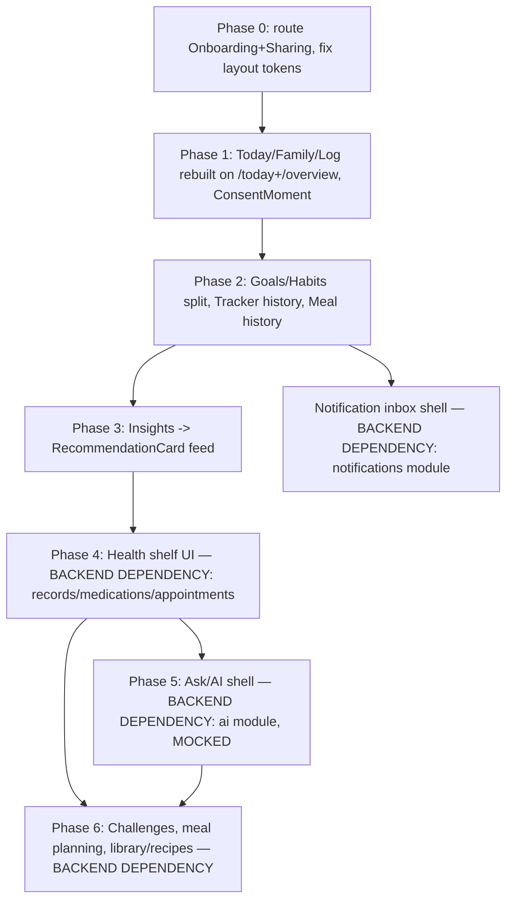

# Frontend Wellness Platform Implementation Plan

- **Version:** 1.0 · **Date:** 2026-09-12
- **Scope:** frontend only. No backend module is proposed or modified by this document.
- **Authority:** this plan does not override `docs/decisions/decision-log.md` (D-001–D-053) or `docs/architecture/wellness-platform-architecture.md`. Every safety and privacy boundary in the decision log is a hard constraint here. Where this plan disagrees with `docs/design/wellness-experience.md` on *presentation* (not on data/permission rules), this plan wins for the reason given in §1.
- **Grounding:** every claim about current code (frontend or backend) below was verified by reading the actual source on 2026-09-12, not inferred from other docs. Every new API call this plan proposes is either confirmed to exist (cited with method + path) or explicitly marked **BACKEND DEPENDENCY REQUIRED**. Nothing here invents an endpoint silently.

---

## 1. Executive summary

**The mandate.** This product must feel like a consumer app first — closer to **HealthifyMe, Flipkart or Blinkit** than to a health-records system. A person opens it and immediately gets an answer to one of four questions: *How am I doing today? What should I eat? How is my family doing? What should I do next?* Everything else — permissions, consent, caregiver delegation, health records, the API layer — is real, necessary, and specified in full below, but it exists **behind** that experience. It is never the thing the user is asked to manage.

This plan was shaped by two rounds of direction from the product owner during planning:
1. The current app is not adaptive (a mobile layout stretched onto desktop with no real use of the extra width) and does not help a user understand their own journey through the product. Fixed.
2. An earlier draft of this plan still read like a CRM — organized around routes, access grants, audit logs and administrative workflows. This version is reorganized around the four consumer questions above, with the administrative machinery nested inside the journey it serves rather than presented as its own destination.

**Method.** Three parallel research passes (decision log + product docs in full; a live audit of `frontend/src`; a live audit of `backend/src/main/java/com/familyfood`) plus direct reads of the routing, shell, and CSS token files established ground truth before any feature was speced. Key findings that shape everything below:

- The backend's `access`, `experience` and `dashboard` modules — the permission engine, the tier/capability system, and the `/today` and `/overview` endpoints — are **already fully built and live**. This is not a future dependency; the frontend can build against real data today.
- Two large, fully-built frontend feature sets — **onboarding** (`features/onboarding/`, 665 lines) and **sharing/caregiving** (`features/sharing/`, 557 lines + `lib/access.ts`, 577 lines) — exist in the codebase but are **wired into nothing**: not imported, not routed. A user cannot reach either today. This is the single highest-leverage fix available and is Phase 0.
- The app's layout is not genuinely responsive. `--content-max: 640px` (`frontend/src/design-system/tokens.css:125`) and repeated per-screen `max-width: 60ch`/`44rem` rules (e.g. `TodayScreen.css:9`, `Goals.css:9`, `FamilyWellness.css:19`, `MealLogScreen.css:9,65`) cap almost every screen to a narrow single column, even though the shell itself already defines `--shell-max: 1240px` (`tokens.css:218`) and uses it correctly for the desktop top bar. The fix is architectural (§5), not cosmetic.
- `notifications`, `library` (recipes/household foods), `records`, `challenges` and `planning` (meal planning/grocery lists) have **zero backend code** — not even an empty controller. `ai` is an empty package. `MEDICATIONS`, `APPOINTMENTS` and `RECORDS` exist only as unoffered `AccessScope` enum values. Every feature in this plan that touches these is explicitly marked **BACKEND DEPENDENCY REQUIRED**, with the shape the frontend needs described so backend work can be scoped from this document.
- The existing design system (`Card`, `ProductCard`/`Rails`/`CategoryRail`, `BottomSheet`, `VerdictChip`, `States`) already contains the right primitives for a consumer feel — card grids, rails, bottom-sheet quick actions. The job is mostly to generalize these into wellness surfaces, not invent a new visual language.

**How to read this document.** §2 sets the standard every screen is held to. §3–§6 cover the structural fixes (sitemap, nav, layout, wayfinding) that apply everywhere. §7–§16 cover the shared architecture (component library, API layer, state, permissions, insights, accessibility, testing). §17 is the phased build order. §18 — the bulk of the document — specs every feature, grouped by the four consumer questions, each with the full field set requested: route, journey, components (existing and new), API dependencies, data, state, all four UI states, permissions, responsive behavior, accessibility, backend/frontend dependencies, and priority. §19 is a from-scratch verified gap list against the current frontend.

---

## 2. Consumer Product Experience Principles

Every screen in §18 is designed against this standard, and every entry closes with a one-line **consumer feel check** answering it directly.

### 2.1 The test

> **Would this feel natural inside HealthifyMe, Flipkart, or Blinkit — or does it read like an enterprise dashboard, an admin console, or a CRM?**

If a screen's first instinct is a table, a settings-style row list, or a multi-field form, that is a signal to redesign it as a card, a feed, a recommendation, or a one-tap action before it ships — not to justify the table because "the data is structured that way." Data structure is a backend concern; a card can present structured data as well as a table can, and reads as a product rather than a system of record.

### 2.2 Reference tone-mapping

| Reference | What we borrow | Where it applies |
|---|---|---|
| **HealthifyMe** | Warm, personal "your day" framing; simple progress bars/tiles for a metric against a goal you set; a companion tone that reports and encourages without judging (constrained here by D-050/D-051 — no streaks, no scores, no red/amber/green, per D-037/D-040) | Today, Goals, Habits, tracker history, the "what's next" recommendation feed |
| **Flipkart / Blinkit** | Search-first discovery; recognizable product cards in scrollable rails; category browsing; fast, visual, low-text; a "buy again" style recency rail | Food discovery, product search/detail, "recently viewed," "log this again" on meals |
| **Both** | Bottom-sheet quick actions instead of full-page forms; large tap targets; one clear primary action per screen; skeleton loading that matches final layout; honest, specific empty states with one next action | Log sheet, goal/habit add, onboarding, every list screen |

### 2.3 Anti-patterns (in addition to the shame/gamification bans already fixed by wellness-experience.md §1.2)

| Anti-pattern | Why it's banned here | Do this instead |
|---|---|---|
| A settings-style row list as the *default* presentation of a feature | Reads as configuration, not as a product moment | A card with the current state and one action ("Priya can see your Water and Activity — Change") |
| Leading with a table before a summary card | Tables are for operators; a consumer wants the headline first | A card/number up top, table (if any) reachable one tap down, only when the person asks for detail |
| A multi-field form where a preset or single tap would do | Every extra field is friction a consumer app doesn't accept | Presets (150/250/500 ml), steppers, segmented pickers — see the Log sheet spec |
| "Management console" language in nav or headings — "Manage grants," "Access control," "Audit log," "Records management" | Names the underlying system, not the user's task | "Sharing," "Who's seen your stuff," "Your health stuff" / "Health shelf" |
| Permissions/consent as their own prominent destination | Turns a feeling ("I trust my family with this") into an IT task | A contextual, one-tap moment inside the flow that needs it (first log attempt, the Family tab) |

### 2.4 What stays consumer-native even though the underlying model is complex

The permission model (D-044), consent purposes (D-048), and caregiver delegation (D-045) are precise and non-negotiable in behavior. None of that complexity should reach the screen as itself:

| Underlying model | Consumer-facing form |
|---|---|
| `AccessGrant{scope, level}` CRUD via `/members/{id}/access-grants` | "Let Priya see your Water and Activity" — a per-category toggle inside **Family**, not an "Access Grants" page |
| Access log (`/members/{id}/access-log`) | "Who's seen your stuff" — a plain activity feed ("Priya viewed your Activity today"), not an audit table with actor/action/resource columns |
| `HealthAccessGrant` relationship types (SELF/GUARDIAN/CAREGIVER/SHARED/NONE) | Never named in the UI as enum values — always a plain-English chip ("You," "You look after," "You help," "Shares with you") |
| Records/medications/appointments (P4, backend not built) | A **health shelf**: a few cards on Today/You — "Next dose: 8pm," "Appointment: Dr. Rao, Fri" — never a document-management table |
| Consent purposes (`HEALTH_TRACKING`, `CHILD_WELLNESS_TRACKING`) | A single plain-language card at the moment tracking is first needed, never a "Consent Management" settings section |

---

## 3. Complete frontend sitemap

Route paths below are largely unchanged from the ones already designed in `wellness-experience.md` (they are sensible URLs; the CRM problem was in screen design and IA emphasis, not URL naming). Each row states current status against verified code.

| Route | Screen | Status | Phase |
|---|---|---|---|
| `/` | Home (signed out: browse/marketing) | existing, reused | — |
| `/welcome` | Onboarding ("Just me" / "Me and my family") | **built, unrouted — wire it** | 0 |
| `/today` | Today (personal dashboard) | exists, rebuild against `/members/{id}/today` | 1 |
| `/log/:kind` | Today with the Log sheet open (`kind` = water · activity · sleep · body · readings · mood · habit) | new (meal → `/meals/new`) | 1 |
| `/goals` | Goals | exists, split from Habits | 2 |
| `/habits` | Habits | new route, split out of Goals | 2 |
| `/trackers/:category` | Tracker history (self) | new | 2 |
| `/meals/new` | Log a meal | exists, redesigned | 1 |
| `/meals/:id` | Meal detail (confirm a share) | exists | 1 |
| `/meals` | Meal history (`?filter=awaiting`) | new | 2 |
| `/family` | Family hub | exists, redesigned | 1 |
| `/family/:memberId` | Member view | new (replaces inline `FamilyWellness` per-member block) | 1 |
| `/family/:memberId/trackers/:category` | Member tracker history | new | 2 |
| `/family/:memberId/goals`, `/family/:memberId/habits` | Member goals/habits | new | 2 |
| `/family/:memberId/profile` | Child profile (guardian) | exists (`ProfilePanel`), routed | 1 |
| `/food` | Food home (search, categories, rails, scan) | exists (`HomeScreen` content), renamed destination | 1 |
| `/search`, `/scan`, `/product/:id`, `/compare` | unchanged | existing | — |
| `/food/recent` | Recently viewed products | rename of `/activity` (collides with ACTIVITY tracking) | 1 |
| `/you` | You (personal hub) | rebuild of `SettingsScreen` | 1 |
| `/you/profile` | Your profile | exists (`ProfilePanel`), routed | 1 |
| `/you/sharing` | Sharing (nested consumer design, §18 Journey 3) | **built, unrouted — wire it** | 0 |
| `/you/sharing/:audienceMemberId` | Share with one person | **built, unrouted — wire it** | 0 |
| `/you/sharing/help` | Ask someone to help | **built, unrouted — wire it** | 0 |
| `/you/shared-with-me` | Shared with you | **built, unrouted — wire it** | 0 |
| `/you/access-log` | "Who's seen your stuff" | **built, unrouted — wire it** (rename/restyle per §2.4) | 0 |
| `/you/household` | Household members, invite, add child | move from `/family` | 1 |
| `/you/appearance` | Dark mode, larger text | exists, extend with larger-text toggle | 1 |
| `/you/data` | Download/delete my data | exists | — |
| `/next` | "What's next" — insights, health shelf, notifications inbox | new, replaces a would-be separate `/records`, `/medications`, `/appointments`, `/notifications` set (§18 Journey 4 explains why these are one surface, not four) | 3–4 |
| `/next/insights` | Full insights history (Today/Week/Month/Long-term) | new | 3 |
| `/next/health-shelf` | Records/medications/appointments detail | new, **BACKEND DEPENDENCY REQUIRED** | 4 |
| `/next/ask` | Ask (natural-language questions) | new, **BACKEND DEPENDENCY REQUIRED**, MOCKED | 5 |
| `/legal/*`, `/ops*`, `/404` | unchanged | existing | — |

**Redirects:** `/settings` → `/you` · `/activity` → `/food/recent` · `/goals?member=:id` → `/family/:id/goals` · signed-in health route while `mode = NONE` → `/welcome?next=<path>` · signed-out visitor to a signed-in route → `/you?next=<path>` (same-origin relative paths only, open-redirect guard).

---

## 4. Navigation structure

The existing 5-slot nav (`AppShell.tsx`) is **kept as-is structurally** and confirmed to already be intent-driven, which is why it survives the reframe:

| Slot | Label | Maps to consumer question |
|---|---|---|
| Today | "How am I doing today?" | direct |
| Family | "How is my family doing?" | direct |
| **Log** (center button, opens a sheet — not a page) | an action, reachable from anywhere | supports all four |
| Food | "What should I eat?" | direct |
| You | (identity, not a question — where the "behind the experience" plumbing quietly lives) | supporting |

"What should I do next?" does not get its own tab — it is **content that appears inside Today and Family** (a recommendation card, a health-shelf card), not a fifth destination, per §2.1: a consumer app answers "what's next" in context, not by sending the user to a dedicated "Next" tab. (The `/next/*` routes in §3 exist as deep-linkable detail views reached from those cards, not as nav destinations.)

Signed-out nav (4 items, unchanged): Home · Search · Scan · You (sign in/up).

**Desktop (≥1024px):** the existing top bar is kept (`AppShell.tsx` lines 130–160, `AppShell.css` `@media (min-width: 1024px)`). No sidebar is introduced. The fix for desktop wayfinding is what's *inside* each screen (§5), not the nav chrome.

---

## 5. Layout & responsive architecture

### 5.1 Diagnosis

The shell already scales correctly: `--shell-max: 1240px` (`tokens.css:218`) bounds the desktop top bar and `.shell__main` (`AppShell.css:205,222`). The defect is one level down — every screen's own root element re-applies a narrow cap:

```
design-system/base.css:138   .app-shell { max-width: var(--content-max); }   /* 640px, unused class but same pattern repeated per-screen below */
design-system/tokens.css:125 --content-max: 640px;
features/today/TodayScreen.css:9        max-width: 60ch;   (~600px)
features/goals/Goals.css:9,26            max-width: 60ch;
features/household/FamilyWellness.css:19 max-width: 60ch;
features/meals/MealLogScreen.css:9,65    max-width: 60ch / 44rem;
```

At a 1400px browser window, this produces roughly 380px of dead margin on each side of Today or Family — a mobile layout stretched onto a desktop tab, which reads as unfinished next to Flipkart/Blinkit's desktop grids.

### 5.2 Fix: per-archetype width tokens, not one global cap

Replace the single blanket cap with named tokens in `tokens.css`, so a screen opts into the layout that matches what it is instead of inheriting a mobile default:

```css
--layout-form-max: 560px;        /* single-task forms: log sheet, onboarding steps, goal/habit add */
--layout-reading-max: 68ch;      /* prose: legal, an insight's detail text */
--layout-dashboard-max: var(--shell-max);  /* Today, Family, Food home, health shelf — full shell width */
--layout-list-max: 840px;        /* meal history, notifications, access activity feed — a single readable list column, wider than a form but not a full dashboard grid */
```

`--content-max` stays defined (some legal/prose content genuinely wants a narrow column) but stops being the default every screen reaches for; screens explicitly pick the token matching their archetype.

### 5.3 Per-archetype layout rules

| Archetype | Screens | Mobile (<640px) | Tablet (640–1023px) | Desktop (≥1024px) |
|---|---|---|---|---|
| **Dashboard/feed** | Today, Family hub, Food home | 1-column stack | 2-column tile grid | 3–4 column grid up to `--layout-dashboard-max` (1240px); tiles keep a max individual width (~360px) so they don't stretch into unreadable banners — extra width becomes more columns, not wider tiles |
| **Single-task form** | Log sheet, meal log, onboarding step, goal/habit add | full-width, one column | centered, `--layout-form-max` | unchanged — **deliberately stays narrow even on desktop.** This is correct, not a bug: a form doesn't get better by getting wider. Called out explicitly so it is never "fixed" by mistake. |
| **List / feed of items** | Meal history, "who's seen your stuff," notifications, insights history | full-width single column | single column, `--layout-list-max` centered | single column, `--layout-list-max` centered — no split-pane; a consumer list app (Blinkit's order history, Flipkart's notifications) doesn't need a desktop master-detail pane, and adding one here would reintroduce the CRM feel |
| **Card-grid browsing** | Food search results, category rails, "recently viewed," health-shelf cards | horizontal scroll rails / 2-column grid | 3-column grid | 4–5 column grid up to `--layout-dashboard-max`, reusing `Rails.tsx`'s existing responsive grid logic |
| **Prose** | Legal, an insight's full explanation | full width, padded | `--layout-reading-max` | `--layout-reading-max` |

### 5.4 Rollout

This fix lands in **Phase 0**, before any other rebuild, because every screen touched afterward should be written against the new tokens from the start rather than migrated twice. Concretely: add the tokens (§5.2), remove the per-screen `max-width: 60ch`/`44rem` rules on dashboard-archetype screens (Today, Family, Goals list, Food home) and replace with the archetype grid, leave form-archetype screens' narrow width as-is (already correct), and confirm `--layout-list-max` on the few list screens that exist today (meal detail's "who ate it" list).

---

## 6. Journey clarity & wayfinding strategy

Since the nav shell doesn't change, clarity has to come from inside each screen. This is now specified as a checklist applied to every feature in §18, not a separate feature:

1. **State the question.** Each primary screen's heading area implies which of the four questions it's answering (Today already does via its content; Family's empty state literally says "How is your family doing?" is answered here once there's someone to show).
2. **Every empty state names the next action**, never just "nothing here" — already house style (`ux-principles.md`), extended to every new wellness surface without exception (Goals, Habits, tracker history, health shelf, notifications).
3. **Multi-step flows show progress and a way back.** Onboarding ("Step 2 of 4"), the sharing review sheet, the goal/habit add sheet (What → Aim → Number → Period), the ask-for-help wizard (Who → What → Review) — all forward-and-back, never forward-only.
4. **No dead ends — every card links somewhere.** A Today tile links to its tracker history; a Family member card links to member view; a meal's pending share links straight to the confirm action; a health-shelf card links to its detail. §18 enumerates the links for each screen so nothing terminates.
5. **The two orphaned flows are the loudest wayfinding bug today.** Right now there is no way for a user to reach household setup or sharing at all — Phase 0 fixes this by routing code that already exists, which is why it is priority zero, not a nice-to-have.

---

## 7. Individual vs Family mode architecture

**Experience framing (what the user feels):** signing up alone gives a **personal wellness companion** — Today is about you, full stop, and nothing ever asks you to add anyone. The moment a second person joins the household, Family quietly becomes a real **family wellness hub** — a warm feed of how everyone's doing, not a household-management console. Nothing about the first experience implies it was incomplete; nothing about the second implies administrative overhead was just unlocked.

**Technical plumbing behind that feeling (D-035, D-043 — exists in the backend today):** `GET /api/v1/me` returns `mode: NONE | INDIVIDUAL | FAMILY`, backed by a single `household` row with an `is_individual` flag. "Just me" onboarding calls `POST /api/v1/me/individual` (idempotent — a 200 means already provisioned). The flag flips to FAMILY automatically the moment a second member joins; nothing migrates. This is exactly why the UI never has to ask the user to choose a "mode" again after onboarding — it's read from `/me`, not decided per screen.

**Never-nag rule (AC-2.7, hard requirement):** a household of one is never prompted to add family. In practice: the Family tab for `mode = INDIVIDUAL` shows exactly one quiet card ("It's just you for now" + two equal secondary buttons, **Invite an adult** / **Add a child**) and nothing else anywhere in the product references family — no badges, no "complete your household" banners, no modal, ever.

**Subject switching (acting for someone else):** the Log sheet's subject picker and a member view's "Log for {name}" button are the only two places another subject is chosen. The picker lists: you (always), children you guard, adults who made you a caregiver — sourced from the overview's `relationship` field, never a raw member list. See §18 Journey 1 (Log) and Journey 3 (Family) for the full spec.

---

## 8. Shared component architecture

### 8.1 Existing components to reuse as-is (verified in `frontend/src/design-system/`)

| Component | File | Reuse for |
|---|---|---|
| `Card` | `Card.tsx` | the base surface for every card-based screen below |
| `ProductCard`, `ProductCardSkeleton`, `Rails` (`SectionHeader`, `CategoryRail`, `ProductRail`, `ProductGrid`, `Chip`) | `ProductCard.tsx`, `Rails.tsx` | Food discovery (unchanged) **and** the pattern to generalize into the Today/Family/health-shelf card grids — this is the existing "Flipkart/Blinkit feel" component, already responsive |
| `Button` | `Button.tsx` | all primary/secondary/destructive actions |
| `Switch` | `Switch.tsx` | the per-category sharing toggle (§2.4) |
| `BottomSheet`, `ConfirmSheet` | `BottomSheet.tsx` | Log sheet, sharing review, destructive confirmations |
| `States` (`Skeleton`, `EmptyState`, `ErrorState`) | `States.tsx` | every loading/empty/error state in §18 |
| `SearchBar` | `SearchBar.tsx` | Food tab only (unchanged placement, per the existing UXD-02 rule — Today/Family/You get no search row) |
| `VerdictChip`, `AllergenFlag`, `NutritionSummary`, `ReasonList` | respective files | Food discovery and product decisions (unchanged) |
| `HouseholdMemberCard` | `HouseholdMemberCard.tsx` | base for the redesigned Family member card |
| `RowGroup`/`Row` | `RowGroup.tsx` | You hub's short, plain list of profile/appearance/legal rows (a personal-hub list is fine here — it's not the primary product surface) |

### 8.2 New components required

| Component | Purpose | Anatomy | States | Accessibility |
|---|---|---|---|---|
| `ProgressTile` | Today's per-metric tile (water, steps, sleep…) | label, value+unit, sub-line (goal context or "Not logged"), sibling **+** button | logged / not-logged / loading skeleton | whole tile is a link named "{metric}, {value}. Open history."; **+** is a sibling button named "Log {metric}" |
| `RecommendationCard` | the "what should I do next" content unit — one insight or one nudge | icon-free text card: what happened, why it matters (tied to the user's own goal), optionally one suggestion from a closed catalogue | present / "not enough data yet" (coverage-aware, never invents a number) | plain sentence, no color-only meaning |
| `QuickActionChip` | preset buttons in the Log sheet (150/250/500 ml, portion fractions) | radio-group chip | selected/unselected | `role="radiogroup"`, arrow-key navigation |
| `LogSheet` | the bottom-sheet quick-entry surface (water/activity/sleep/body/readings/mood/habit) | tile grid → in-sheet form push, subject switcher header, time chip | loading (tile skeleton) / saving (spinner, label kept) / saved (status line, stays open for next entry) / offline (disabled + hint) | real focus trap, inert background, visible Close button, `#log` history entry so Android back closes the sheet |
| `SubjectSwitcher` | "Logging for: You ▾" | native select or listbox sheet | — | labelled, keyboard-operable |
| `ConsentMoment` | the in-context consent ask (adult and child variants) | title, 2–3 plain bullets, equal-weight **Turn on tracking** / **Not now** | — | equal-size actions, no pre-ticked box, attestation checkbox for child variant |
| `FamilyMemberCard` | one card per Family hub row | avatar-initial, name, relationship chip (plain English), up to 4 metric lines, `Log`/`Open` actions | consent-off / not-shared / identity-only (NONE) | whole card is a link only when there is something to open; server order preserved, never re-sorted |
| `RelationshipChip` | "You" / "You look after" / "You help" / "Shares with you" | text chip, no color-coded meaning | — | text-based, not color-alone |
| `HistoryChart` | tracker-history chart | inline SVG bars (SUM) or dots (LATEST/CLINICAL), gaps for not-logged days, optional dashed goal line | empty (no chart drawn, text only) | `<figure>`/`<svg role="img">` with title+desc, plus a "Show as table" toggle exposing a real `<table>` |
| `HealthShelfCard` | one card per record/medication/appointment on Today/You | icon-free label, one key fact, one date/time, tap-through to detail | loading / empty ("Nothing here yet — add your first…") | plain sentence, no severity color |
| `StepIndicator` | "Step 2 of 4" for multi-step flows | text + optional dots | — | announced via `aria-current` on the active step |
| `ActivityFeedRow` | "who's seen your stuff" row (replaces an audit-log table row) | one plain sentence per entry, grouped by day | — | sentence-first, no icon-only meaning |

---

## 9. Design-system requirements

**New tokens (add to `tokens.css`; no raw values in components):**

```css
/* layout (see §5.2) */
--layout-form-max: 560px;
--layout-reading-max: 68ch;
--layout-dashboard-max: var(--shell-max);
--layout-list-max: 840px;

/* charts and recommendation surfaces */
--chart-bar: var(--brand);
--chart-goal-line: var(--text-secondary);   /* dashed, SUM goals only */
--chart-grid: var(--border);
--chart-axis-text: var(--text-tertiary);
--pending-bg: var(--surface-sunken);
--pending-fg: var(--text-secondary);
--attention-bg: var(--brand-subtle);        /* recommendation/attention cards — never --danger */
--attention-rule: var(--brand);
```

**Accessibility rules carried forward and applied to every new component:** 44×44px minimum touch target (48px primary), color never the only signal, focus ring never removed, `aria-live="polite"` for save confirmations, larger-text mode (`html[data-text-size="large"]`, 1.25× scale, 48/56px targets) available from You → Appearance and offered once to OLDER_ADULT tier — spec unchanged from the existing design system, extended to `ProgressTile`, `RecommendationCard`, `HealthShelfCard`.

**Banned-vocabulary extensions** (add to `i18n.vocabulary.test.ts`'s `BANNED` list, `claimOnly` where negation is legitimate): missed · you broke · streak lost · cheat meal/day · guilt-free · off track · overweight · obese · underweight · normal range · abnormal · ideal weight · target weight · calories left · picky · overeating. Context-bound (checklist, not regex): failed · streak (any user copy pre-P6) · good day/bad day · on track · elevated/high/low about a reading · risk/warning/alert about health data · earn/burn.

---

## 10. API/client layer changes

### 10.1 Existing `lib/` modules — reuse as-is

| Module | Confirmed real endpoints it wraps | Used by |
|---|---|---|
| `lib/me.ts` (`getMe`/`useMeQuery`) | `GET /api/v1/me` | mode/tier/capabilities everywhere |
| `lib/dashboard.ts` (`useTodaySummary`, `useFamilyOverview`) | `GET /api/v1/members/{id}/today`, `GET /api/v1/households/{id}/overview` | Today, Family hub |
| `lib/access.ts` | `GET /access/scopes`, `GET/POST/DELETE /members/{id}/access-grants`, `GET /me/shared-with-me`, `GET /members/{id}/access-log`, `GET /members/{id}/access` | Sharing (§18 Journey 3) |
| `lib/goals.ts` | `POST/GET /goals`, `POST /goals/{id}/end`, `GET /goals/progress`, plus habits (`POST/GET /habits`, completions, consistency) | Goals, Habits |
| `lib/wellness.ts` | `GET /wellness/metrics`, `POST/GET /wellness/members/{id}/observations[/{metric}]`, `GET /wellness/members/{id}/visibility` — **note:** its `listShares`/`share`/`unshare` exports target the removed `/wellness/members/{id}/shares` endpoint and must be deleted (dead code, see §19) | Log sheet, tracker history |
| `lib/nutritionLog.ts` | `POST/GET/PUT/DELETE /nutrition/meals`, `POST /nutrition/meals/{id}/confirm`, `GET /nutrition/members/{id}/meals` | Meal log/detail |
| `lib/insights.ts` | `GET /insights/members/{id}?window=` | Today teaser, insights history |
| `lib/consent.ts` | `GET /consent/policies`, `POST/DELETE/GET /consent/members/{id}/grants` | `ConsentMoment` |
| `lib/profile.ts` | `GET/PUT /households/{id}/members/{id}/profile` | Profile, onboarding step 3 |
| `lib/household.ts` | household/member/invitation CRUD | You → Household |

### 10.2 New client modules needed (backend already supports these)

- `lib/recommendations.ts` — a thin composition layer over `lib/insights.ts` that shapes insight output into `RecommendationCard` props for the Today/Family "what's next" surface. No new backend endpoint; pure frontend composition.
- Small additions to `lib/dashboard.ts` types to surface `mealsAwaitingConfirmation`, `habits` (`DaySummary`), and `canLogNutrition` fields already returned by `/today` and `/overview` but not yet consumed by the current `TodayScreen`/`FamilyWellness`.

### 10.3 New client modules — BACKEND DEPENDENCY REQUIRED

| Module | Needed for | What's missing today | Suggested contract to hand to backend |
|---|---|---|---|
| `lib/notifications.ts` | in-app inbox + preferences | zero backend code (`notifications` package doesn't exist) | `GET /api/v1/me/notifications`, `GET/PUT /api/v1/members/{id}/notification-preferences`, per D-050: per-category opt-in, quiet hours, daily cap, never addressed to a child |
| `lib/healthShelf.ts` | records/medications/appointments cards | `records`/`ai` packages don't exist; `MEDICATIONS`/`APPOINTMENTS`/`RECORDS` are unoffered `AccessScope` values only | `GET /api/v1/members/{id}/records`, `/medications`, `/doses`, `/appointments` — per D-049: metadata + private-bucket file, no OCR/AI processing, medications are user-entered text only, never dose calculation |
| `lib/ai.ts` | Ask, AI-phrased summaries | `ai` package is an empty stub directory | `POST /api/v1/ask` (closed intents only, per D-052), `GET /api/v1/members/{id}/summary?period=` — must ship labelled MOCKED until a model credential + privacy review exist (D-011, D-052) |
| `lib/library.ts` | household foods/recipes | `library` package doesn't exist | `GET/POST /api/v1/households/{id}/foods`, `/recipes` |
| `lib/challenges.ts`, `lib/planning.ts` | cooperative challenges, meal planner, grocery lists | `challenges`/`planning` packages don't exist | per D-051 (adults-only, no ranking, no weight challenges ever) and D-042 (no commerce) |

---

## 11. State/data-flow architecture

No new state library is introduced — TanStack Query (already the sole server-state tool) and the existing session/theme pattern (module-level state + `useSyncExternalStore`, `lib/useSession.ts`) are sufficient and idiomatic here.

**Query key convention:** `['me']`, `['today', memberId, date]`, `['overview', householdId, date]`, `['goals', memberId]`, `['habits', memberId]`, `['access-grants', memberId]`, `['insights', memberId, window]`. Precise invalidation only — e.g. saving a water entry invalidates `['today', subjectId, date]` and `['goals', subjectId]`, never the whole `['wellness']` tree.

**"One source per screen" discipline (carried forward from the existing architecture, now stated as a rule for every new screen):** Today reads only `/members/{me}/today` + `/members/{me}/meals` + an insights teaser — it never sums observations client-side or calls per-metric endpoints in a loop. Family hub reads only `/households/{id}/overview` — it never fans out to `/goals`, `/habits` or `/visibility` per member (this exact fan-out is a currently-live defect, see §19 G-01).

---

## 12. Route and permission strategy

Every screen renders from **server-given capability flags**, never from client-side inference (D-046 is absolute on this point): `GET /me` and `GET /members/{id}/experience` return `experience` tier and a `capabilities` object; the UI renders exactly those flags and never derives a tier from `ageBand` or `memberType` itself.

**Guard pattern:** a small `<RequireCapability>`/`<RequireScope>` wrapper (new, thin) reads the already-fetched `/access` or `/experience` response and renders its children, a "not shared with you" state, or nothing, per §2.4's principle that this machinery is invisible until it's the reason something can't be shown.

**403-avoidance ("the UI never discovers access by trying," carried forward as a hard rule):** every cross-member surface reads `/households/{id}/overview` or `/members/{id}/access` first and only requests scopes it already knows it may see. A probe that gets refused writes a REFUSED row into the *subject's* access log — visible to them as "so-and-so tried to view your X" — so a client that probes needlessly pollutes another person's trust feed. This is why Family hub must use the overview endpoint exclusively (§11) rather than per-member calls.

---

## 13. Insight/recommendation presentation architecture

Framed here explicitly as **"what should I do next" content**, not an analytics feature — this is the point of Journey 4 in §18.

```
observations/goals/habits/meals (visible to caller)
   → window: TODAY | WEEK | MONTH | LONG_TERM, member-local days
   → detectors: own-baseline trend · goal days-met · habit consistency · coverage · meal regularity · sleep timing · adult weight trend
   → typed Insight { type, scope, metric, direction, magnitude, window, evidence[], suggestionKey }
   → rendered as a RecommendationCard: what happened (evidence-backed) · why it matters (the user's own goal) · what to consider (a closed, non-medical suggestion catalogue)
```

Insights are **derived, never stored** — there is no dismiss/create endpoint, and none is needed; the card simply stops appearing when its evidence no longer holds. Family recommendations use only scopes the caller can see and never rank members (D-038 aggregate rule) — a two-person total is shown only if both members share that scope.

---

## 14. Accessibility strategy

| WCAG 2.2 AA criterion | Concrete requirement here |
|---|---|
| 1.3.1 Info & relationships | `ProgressTile`s are `<li>` in a labelled `<ul>`; the metric label+value sit in one link, the **+** button is a sibling |
| 1.4.1 Use of colour | Done/not-done, active tab, pending, selected all carry text or a glyph, never colour alone |
| 1.4.3/1.4.11 Contrast | Design tokens only, no raw hex in components (already the house rule) |
| 2.1.1 Keyboard | `QuickActionChip` groups use arrow keys; `LogSheet` opens with focus on its heading and returns focus to the invoking control on close |
| 2.4.11 Focus not obscured | `scroll-padding-bottom` on `main` accounts for the bottom nav + any sticky save bar |
| 2.5.8 Target size | 44×44px minimum everywhere, 48px primary — this explicitly fixes the current habit-strip defect (§19 G-05) |
| 4.1.3 Status messages | Saves and toggles announced via `role="status"`; form errors via `role="alert"` on submit only |

**Closing the existing coverage gap:** no axe test or formal accessibility audit exists today (confirmed against `requirements-traceability.md`'s NFR-13 = PARTIAL). §15 adds an axe-core pass to the new component-test suite so this stops being a standing gap.

---

## 15. Testing strategy

Today: Vitest + Testing Library are installed but only 3 pure-logic test files exist; no component tests, no MSW, no ESLint script wired, and **no browser-automation tool has ever been available in this environment** — every past UI claim was verified by reading markup/CSS, never a rendered screenshot.

**Plan:**
1. Introduce MSW (new dependency) to mock the confirmed real endpoints from §10.1, so component tests don't hit a live backend.
2. Add component tests (Testing Library, already installed) for every new component in §8.2, plus the rebuilt Today/Family screens — happy path, empty state, error state, and one permission-filtered case (SHARED/NONE relationship) per screen.
3. Extend `i18n.vocabulary.test.ts`'s banned list per §9.
4. Add an axe-core pass (new dependency) to the component-test suite for every screen in §18.
5. **Because no browser automation exists here**, each phase in §17 closes with an explicit manual verification step (run the dev server, click through the golden path and one edge case per screen) before being marked done — and this plan recommends introducing Playwright as infrastructure work in Phase 1, not deferred indefinitely, so future phases don't repeat this gap.

---

## 16. Feature dependency graph



---

## 17. Recommended implementation phases

| Phase | Contents | Exit criteria |
|---|---|---|
| **0 — Unlock what already exists** | Route `OnboardingScreen`, `SharingScreen` + its 4 supporting files into `App.tsx`; add `/welcome`, `/you/*` redirects; land the layout-token fix (§5) across Today/Goals/Family/Food before any of them are otherwise touched | A new user can complete onboarding; an existing user can reach Sharing and the access feed; Today/Family/Food use full shell width on desktop with no behavior change yet |
| **1 — Real dashboards** | Today and Family rebuilt on `/members/{id}/today` and `/households/{id}/overview` (closing the client-side summing/fan-out defects in §19); Log sheet replaces the current inline quick-log; `ConsentMoment` as a designed state instead of inline error text; profile completion (activity level, body measurements as observations) | Every number on Today/Family traces to a server field, not a client sum; a consent-off user sees a designed card, not red error text; onboarding → Today → Log → Family is a complete, dead-end-free loop |
| **2 — Tracking depth** | Goals/Habits split into their own routes; tracker history (`/trackers/:category`); meal history/awaiting list; notification inbox **shell** (UI ready, wired once backend lands) | Every tracker writes through the Log sheet; habit strip meets the 44px target; no tracker has its own bespoke logging path |
| **3 — What's next, for real** | Insights rebuilt as `RecommendationCard` feed on Today/Family, replacing raw server-prose rendering | Every recommendation card traces to evidence; family recommendations never rank members |
| **4 — Health shelf** | Records/medications/appointments UI, specced against the D-049 data shape, held behind a feature flag until backend exists and the legal release gate clears | UI complete and reviewable against mocked data; not shipped to production until D-049 is ACCEPTED and backend exists |
| **5 — Ask** | AI/Ask UI, clearly labelled MOCKED, no live call until a model credential + privacy review exist | Shell reviewable; cannot be enabled in production without the credential |
| **6 — Differentiation** | Challenges (adults-only, no ranking), meal planning/grocery lists, household library/recipes | All backend-dependent; light spec only pending those modules |

---

## 18. Feature-by-feature specifications

Organized by the four consumer questions. Every entry: Route/page · User journey · Components (existing/new) · API dependencies · Data required · State management · Loading/Empty/Error/Success states · Permissions/visibility · Responsive behavior · Accessibility · Backend dependency · Frontend dependency · Priority · **Consumer feel check**.

### Journey 1 — "How am I doing today?"

#### 1.1 Today (personal dashboard)

- **Route:** `/today`
- **Journey:** open the app → immediately see today's numbers, what's due, and one or two things worth noticing — no navigation required to answer "how am I doing."
- **Wireframe — mobile:**
  ```
  ┌──────────────────────────────┐
  │ Today          Sat, 12 Sep   │
  │ ┌───────────────────────────┐│  attention/recommendation card
  │ │ Water logged on 5 of 7    ││  (--attention-bg, never red)
  │ │ days this week.        ›  ││
  │ └───────────────────────────┘│
  │ ┌───────────┐┌──────────────┐│  ProgressTile grid, 2 cols
  │ │ Meals  [+]││ Water    [+] ││
  │ │1,420 kcal ││ 1.5 of 2 L   ││
  │ └───────────┘└──────────────┘│
  │ ┌───────────┐┌──────────────┐│
  │ │Activity[+]││ Sleep    [+] ││
  │ │Not logged ││ 7h 20m       ││
  │ └───────────┘└──────────────┘│
  │ Habits: 2 of 3 done       ›  │
  │ Meals today                  │
  │  Breakfast · 420 kcal     ›  │
  └──────────────────────────────┘
  ```
- **Wireframe — desktop (≥1024px, real grid, not a stretched column):**
  ```
  ┌────────────────────────────────────────────────────────────────┐
  │ Today                                          Sat, 12 Sep      │
  │ ┌──────────────────────────────────────────────────────────┐   │
  │ │ Water logged on 5 of 7 days this week.                 › │   │
  │ └──────────────────────────────────────────────────────────┘   │
  │ ┌──────────┐ ┌──────────┐ ┌──────────┐ ┌──────────┐            │
  │ │ Meals [+]│ │ Water [+]│ │Activity[+│ │ Sleep [+]│  4-col grid│
  │ └──────────┘ └──────────┘ └──────────┘ └──────────┘            │
  │ Habits: 2 of 3 done ›            Meals today                    │
  │ [✓] Walk after dinner            Breakfast · 420 kcal ›         │
  │ [ ] Fruit at breakfast           Lunch · 610 kcal ›              │
  └────────────────────────────────────────────────────────────────┘
  ```
- **Components:** existing `Card`, `States`; new `ProgressTile`, `RecommendationCard`, `DayNavigator` (‹ Sat, 12 Sep ›, `?date=` past dates only).
- **API:** `GET /api/v1/members/{me}/today?date=` (EXISTS), `GET /api/v1/nutrition/members/{me}/meals?from=&to=` (EXISTS), `GET /api/v1/insights/members/{me}?window=WEEK` (EXISTS, teaser capped at 2 cards).
- **Data:** `TodayView{metrics[], goals[], habits, mealsAwaitingConfirmation, trackingConsentActive}`.
- **State:** `['today', memberId, date]`, `['insights', memberId, 'WEEK']`; invalidated on any Log-sheet save for that subject/date.
- **States:** Loading = skeleton matching the tile grid; Empty (new user) = all tiles "Not logged" + "Tap **Log** to add your first entry"; Error = per-section `ErrorState`, one failing section never blanks the page; Consent-off = `ConsentMoment` card replaces the tile grid, Food shortcut stays reachable; Offline = cached day + banner, `+` disabled with a reason.
- **Permissions:** self-only; server returns nulls for anything not yet profiled (tier UNKNOWN → profile-needed card instead of tiles).
- **Responsive:** dashboard archetype (§5.3) — 1→2→4 columns.
- **Accessibility:** tile = one link named "{metric}, {value}. Open history."; `+` is a named sibling button; day nav buttons named "Previous/Next day," next disabled on today.
- **Backend dependency:** none — `/today` exists today.
- **Frontend dependency:** Phase 0 layout tokens; `LogSheet` (1.2).
- **Priority:** Phase 1.
- **Consumer feel check:** a HealthifyMe-style "your day" screen — numbers and one recommendation up front, no settings, no tables. Passes.

#### 1.2 Log (quick-entry sheet)

- **Route:** opens over any screen at `#log`; deep link `/log/:kind`.
- **Journey:** tap the center nav button from anywhere → pick what to log → one screen, presets where possible → save → sheet stays open for the next entry.
- **Components:** new `LogSheet`, `QuickActionChip`, `SubjectSwitcher`; existing `BottomSheet`.
- **API:** `POST /api/v1/wellness/members/{id}/observations` (EXISTS), `POST /api/v1/nutrition/meals` (EXISTS, meal tile routes to `/meals/new` instead of an in-sheet form), habit completion `PUT /api/v1/habits/{id}/completions/{date}` (EXISTS).
- **Data:** tiles shown = intersection of the subject's `capabilities.trackableMetrics` and the kinds table (water/activity/sleep/mood/habits/body/readings — body & readings adult-subjects only, never shown for a child).
- **State:** mutation invalidates `['today', subjectId, date]` + `['goals', subjectId]` on success.
- **States:** Loading = 3×3 tile skeleton; Consent-off = tiles visible, tapping one opens `ConsentMoment`; Error = inline, value preserved; Offline = tiles visible, Save disabled with a plain reason (no offline write queue, by design — a wrong number saved twice is worse than a short wait).
- **Permissions:** logging for someone else requires MANAGE on that scope (from `/members/{id}/access`) — enforced by only showing tiles the subject picker's target actually permits, never by showing then rejecting.
- **Responsive:** form archetype — stays narrow even on desktop (§5.3), 3-up tile grid collapsing to a list in larger-text mode.
- **Accessibility:** real focus trap, visible Close button, `#log` history entry so Android back closes the sheet not the app.
- **Backend dependency:** none.
- **Frontend dependency:** none — first thing built in Phase 1.
- **Priority:** Phase 1.
- **Consumer feel check:** a Blinkit-style quick-add sheet with presets, not a form. Passes.

#### 1.3 Goals & Habits progress

- **Route:** `/goals`, `/habits` (split; today they're one combined screen)
- **Journey:** see your own numbers against a target you set, in plain language ("1.5 of 2 L"), never a graded score.
- **Components:** existing `GoalProgressList`, `HabitList` (rebuilt); new `ProgressTile`-style bar (no color-coded fill).
- **API:** `POST/GET /api/v1/goals`, `GET /api/v1/goals/progress` (EXISTS); `POST/GET /api/v1/habits`, completions, consistency (EXISTS).
- **Data/State:** `['goals', memberId]`, `['habits', memberId]`.
- **States:** Empty = "No goals yet. A goal is a number you choose, like how much water to drink in a day. **Add a goal**"; Not-shared (viewing someone else) = "{name} hasn't shared any goals with you."
- **Permissions:** offer set is `capabilities.goalCategories × goalDirections` from `/experience`, never hardcoded client-side (fixes a live defect, §19 G-04); child subjects get ACTIVITY/SLEEP/HYDRATION only, AT_LEAST/AROUND only, ever (D-047, permanent).
- **Responsive:** list archetype.
- **Accessibility:** 44px habit-strip cells (fixes the current under-sized strip, §19 G-05); progress bar `aria-hidden`, text carries the meaning.
- **Backend dependency:** none.
- **Priority:** Phase 2.
- **Consumer feel check:** reads like a personal tracker (HealthifyMe), not a KPI dashboard — no scores, no grades, no red/green. Passes.

#### 1.4 Tracker history

- **Route:** `/trackers/:category`
- **Journey:** tap a Today tile → see the trend behind today's number.
- **Components:** new `HistoryChart`; existing `Chip` (range selector: 7/30/90 days).
- **API:** `GET /api/v1/wellness/members/{id}/observations/{metric}?from=&to=` (EXISTS).
- **States:** Empty = "No {metric} logged in the last {n} days" + **Log {metric}** (no empty axis of zeros); Not-shared (another member) = plain sentence, no chart at all.
- **Responsive:** list/detail archetype — single column even on desktop, per §5.3's explicit no-master-detail rule for consumer list screens; chart is full-width up to `--layout-list-max`.
- **Accessibility:** chart is an `<svg role="img">` with a text summary sentence as its `<desc>`, plus a "Show as table" toggle.
- **Priority:** Phase 2.
- **Consumer feel check:** one clear chart and a plain sentence, not an analytics dashboard. Passes.

#### 1.5 Profile & tracking consent (inline, not a settings trip)

- **Route:** `/you/profile` (self), `/family/:id/profile` (child, guardian)
- **Journey:** completed once, briefly, at onboarding or the first time a tile needs it — never a separate "complete your profile" campaign.
- **API:** `GET/PUT /api/v1/households/{id}/members/{id}/profile` (EXISTS).
- **States:** Profile-needed (tier UNKNOWN) = one card on Today itself ("Add your age band to start tracking"), not a forced redirect.
- **Backend dependency:** none.
- **Priority:** Phase 1.
- **Consumer feel check:** one short card, not an "account setup" wizard. Passes.

### Journey 2 — "What should I eat?"

#### 2.1 Food discovery home

- **Route:** `/food` (existing `HomeScreen` content, signed-in)
- **Journey:** unchanged — this screen is already the product's best consumer-app example (search bar, category rails, product cards) and is the reference the rest of the app is being redesigned toward, not the other way around.
- **Components:** existing `SearchBar`, `CategoryRail`, `ProductRail`, `ProductGrid` — no changes needed beyond moving the household-food-profile card here from Family (see §19 G-06) and giving it `--attention-bg` styling instead of verdict colors.
- **Priority:** Phase 1 (the move), otherwise unchanged.
- **Consumer feel check:** already passes — this is the Blinkit/Flipkart reference itself.

#### 2.2 Personalized product decisions (self + family)

- **Route:** `/product/:id` (existing), extended
- **Journey:** search a product → see a verdict for you → optionally "see this for {family member}" using shared `FOOD_PROFILE` scope.
- **API:** existing scoring endpoints (EXISTS) + `GET /api/v1/members/{id}/access` (EXISTS) to know which family members' `FOOD_PROFILE` is shared.
- **Permissions:** `FOOD_PROFILE` scope is currently `offered=false` server-side (confirmed) — evaluating for someone beyond self/guarded children is **not offered yet**; the plan specs the UI to appear the moment the scope is offered, with no UI shipped before that (per the "no dead links" house rule).
- **Priority:** Phase 2.
- **Consumer feel check:** a natural "does this fit my family" extension of the existing PDP. Passes.

#### 2.3 Log a meal, family apportioning

- **Route:** `/meals/new`, `/meals/:id`
- **Journey:** "log what you ate" in three plain steps — what, who, when — not a bureaucratic multi-fieldset form.
- **Components:** existing `MealLogScreen`/`MealDetailScreen` (redesigned), `SearchBar` for catalogue items.
- **API:** `POST/GET/PUT/DELETE /api/v1/nutrition/meals`, `POST /nutrition/meals/{id}/confirm` (all EXISTS, including `inMemberLog`/`nutritionWithheld` fields already returned).
- **States:** each selected member gets one plain destination sentence ("Goes into your log" / "Saved with the meal. Goes into {name}'s log when {name} adds it.") stated *before* saving, sourced from the overview's `relationship`/`canLogNutrition`/`trackingConsentActive` — never inferred from member type (fixes a live P0 defect, §19 G-02).
- **Permissions:** whole-meal total is hidden from a viewer when any share is withheld from them (prevents reconstructing a withheld share via arithmetic).
- **Priority:** Phase 1.
- **Consumer feel check:** three short steps with plain-language destination lines, not a form with fieldsets. Passes with the redesign.

#### 2.4 Household food library / recipes

- **Route:** new, under `/food`
- **Journey:** "my foods" — save a home-cooked dish once, log it again with one tap next time (a "buy again" pattern, Blinkit-style).
- **API:** **BACKEND DEPENDENCY REQUIRED** — `GET/POST /api/v1/households/{id}/foods`, `/recipes` (`library` module does not exist).
- **Priority:** Phase 6.
- **Consumer feel check:** designed as a recency rail ("Recently made"), not a recipe database UI.

### Journey 3 — "How is my family doing?"

#### 3.1 Family hub

- **Route:** `/family`
- **Journey:** a warm, at-a-glance feed of how everyone's doing — never a roster or a management screen.
- **Wireframe — mobile:**
  ```
  ┌──────────────────────────────┐
  │ Family          Sat, 12 Sep  │
  │ ┌───────────────────────────┐│  own-awaiting-meals card only
  │ │ Your share of Dinner isn't││
  │ │ in your log yet.   Review›││
  │ └───────────────────────────┘│
  │ ┌───────────────────────────┐│  FamilyMemberCard, one per person
  │ │ (M) Mohan            You  ││
  │ │ Meals 1,420 kcal · Water..││
  │ │            [Log] [Open ›] ││
  │ └───────────────────────────┘│
  │ ┌───────────────────────────┐│
  │ │ (A) Aarav   You look after││
  │ │ Meals 3 logged · Water..  ││
  │ │            [Log] [Open ›] ││
  │ └───────────────────────────┘│
  └──────────────────────────────┘
  ```
- **Wireframe — desktop (card grid, not a stretched list):**
  ```
  ┌────────────────────────────────────────────────────────────────┐
  │ Family                                          Sat, 12 Sep     │
  │ ┌───────────────────────────────────────────────────────────┐  │
  │ │ Your share of Dinner isn't in your log yet.       Review › │  │
  │ └───────────────────────────────────────────────────────────┘  │
  │ ┌───────────────┐ ┌───────────────┐ ┌───────────────┐          │
  │ │ Mohan · You   │ │ Aarav · look  │ │ Priya · shares│  3-col   │
  │ │ Meals 1,420   │ │ after         │ │ with you      │  grid    │
  │ │ [Log][Open ›] │ │ [Log][Open ›] │ │ [Open ›]      │          │
  │ └───────────────┘ └───────────────┘ └───────────────┘          │
  └────────────────────────────────────────────────────────────────┘
  ```
- **Components:** new `FamilyMemberCard`, `RelationshipChip`.
- **API:** `GET /api/v1/households/{id}/overview?date=` (EXISTS — single call, no per-member fan-out).
- **States:** Individual mode = the one quiet "just you for now" card (§7), never anything else; Loading = 3 card skeletons; Error = one `ErrorState` for the whole overview with retry.
- **Permissions:** every card renders only what `visibleScopes` allows; NONE relationship = identity-only card, not a link.
- **Responsive:** dashboard archetype, 1→3-column grid.
- **Backend dependency:** none.
- **Priority:** Phase 1.
- **Consumer feel check:** a feed of people, like a family group chat's status view — not a household admin roster. Passes.

#### 3.2 Sharing & caregiving (nested inside Family, presented simply)

- **Route:** `/you/sharing`, `/you/sharing/:audienceMemberId`, `/you/sharing/help`
- **Journey:** "Let Priya see your Water and Activity" — a short list of people you can share with, each with a couple of plain toggles, not an access-control panel.
- **API:** all confirmed EXISTS (§10.1 `lib/access.ts`).
- **Design change from the existing built screen:** the existing `SharingScreen`/`GrantSheets` code is functionally complete and reused, but headings/copy are checked against §2.3 — no "Access Grants," no "Manage permissions"; the working title is "Sharing," and per-person controls read "Not shared / Can see / See and log" (already the copy the built screen uses — confirm and keep).
- **Priority:** Phase 0 (routing) — this is one of the two zero-cost unlocks.
- **Consumer feel check:** a short list of people and two-option toggles, not a permissions matrix. Passes once routed.

#### 3.3 "Who's seen your stuff" (access activity feed)

- **Route:** `/you/access-log`
- **Journey:** a plain activity feed, not an audit table.
- **API:** `GET /api/v1/members/{id}/access-log` (EXISTS).
- **Components:** new `ActivityFeedRow` — one sentence per event ("Priya viewed your Activity, Sleep — as someone you share with — 8:10 pm"), grouped by day.
- **Priority:** Phase 0 (routing of the existing screen) + a copy/structure pass to ensure it reads as a feed, not a log table.
- **Consumer feel check:** reads like a notifications feed, not a SIEM console. Passes with the `ActivityFeedRow` treatment.

#### 3.4 Age-specific experiences (presentation rules, not a separate screen)

- Applies across Journeys 1, 3: CHILD subjects never show BODY/CLINICAL tiles, never get streaks/badges/notifications (permanent, D-036/D-051); OLDER_ADULT gets a reordered Today (helpers card first) and an offered larger-text mode, never a restricted one; tier is always server-given (`/experience`), never inferred.
- **Priority:** woven into Phase 1 (Today/Family) rather than a standalone build item.

#### 3.5 Household management

- **Route:** `/you/household`
- **Journey:** invite an adult, add a child, leave — a short administrative list that deliberately *is* allowed to look like a plain list, because it's genuinely a one-time setup task, not a recurring product surface (this is the one place in the product where a row-list is the right pattern, per §2.1's actual test — it would feel odd in HealthifyMe/Blinkit to over-design a one-time "invite" flow into a card feed).
- **Priority:** Phase 1 (move from `/family`).

### Journey 4 — "What should I do next?"

#### 4.1 Insights → recommendation feed

- **Route:** surfaced inline on Today/Family; full history at `/next/insights`
- **Journey:** the app tells you something worth noticing and, where it can, one non-medical thing to consider — never a dashboard you have to go read.
- **Components:** new `RecommendationCard` (§8.2), replacing the current raw-prose `InsightList`.
- **API:** `GET /api/v1/insights/members/{id}?window=` (EXISTS; typed `messageKey` rendering is a P3 backend enhancement noted in §19 but the endpoint itself exists today).
- **Priority:** Phase 3.
- **Consumer feel check:** a HealthifyMe-style "noticed this about your week" card. Passes.

#### 4.2 Health shelf (records, medications, appointments — one consumer surface for three P4 domains)

- **Route:** cards on Today/You; detail at `/next/health-shelf`
- **Journey:** "your health stuff" — a next dose, an upcoming appointment, a recent record photo — as a small set of cards, never a document-management system.
- **Wireframe — mobile:**
  ```
  ┌──────────────────────────────┐
  │ Your health stuff             │
  │ ┌───────────────────────────┐│
  │ │ Next dose: Metformin, 8pm ││
  │ └───────────────────────────┘│
  │ ┌───────────────────────────┐│
  │ │ Appointment: Dr. Rao, Fri ││
  │ └───────────────────────────┘│
  │ ┌───────────────────────────┐│
  │ │ Recent: Blood test, 2 Sep ││
  │ └───────────────────────────┘│
  │        [ + Add ]              │
  └──────────────────────────────┘
  ```
- **Wireframe — desktop (card grid, same pattern as Food's category rails):**
  ```
  ┌────────────────────────────────────────────────────────────┐
  │ Your health stuff                                    [+Add]│
  │ ┌────────────┐ ┌────────────┐ ┌────────────┐               │
  │ │ Next dose  │ │Appointment │ │ Recent      │  3-col grid   │
  │ │ Metformin  │ │ Dr. Rao    │ │ Blood test  │               │
  │ │ 8pm        │ │ Fri        │ │ 2 Sep       │               │
  │ └────────────┘ └────────────┘ └────────────┘               │
  └────────────────────────────────────────────────────────────┘
  ```
- **Components:** new `HealthShelfCard`.
- **API: BACKEND DEPENDENCY REQUIRED** — `records`, `ai`, and medication/appointment code do not exist; `MEDICATIONS`/`APPOINTMENTS`/`RECORDS` are unoffered `AccessScope` values only. Needed: `GET/POST /api/v1/members/{id}/records`, `/medications`, `/doses`, `/appointments` per D-049 (metadata + private-bucket file, magic-byte check, short-lived signed URLs, no OCR/AI on medical docs, medications are user-entered text only — never dose calculation or interaction checking).
- **Release gate:** D-049 is PROVISIONAL; this entire surface stays behind a feature flag until the module exists and the legal release gate clears. UI can be fully built and reviewed against mocked data before then.
- **Priority:** Phase 4.
- **Consumer feel check:** three or four plain cards, explicitly not a records table with metadata columns. Passes by design — the risk this plan flags is that the *natural* backend shape (documents, schedules, structured logs) pulls implementers toward a table; the wireframe above is the concrete artifact to hold the line.

#### 4.3 Notifications (inbox + preferences)

- **Route:** inbox surfaced as a simple bell/list, not a settings section; preferences one tap from You
- **API: BACKEND DEPENDENCY REQUIRED** — `notifications` package does not exist. Needed per D-050: `GET /api/v1/me/notifications`, `GET/PUT /api/v1/members/{id}/notification-preferences`, `/reminders`; per-category opt-in, quiet hours, daily cap, engagement categories default OFF, medication/appointment reminders default ON, never addressed to a child.
- **Priority:** Phase 2 (shell), enabled once backend lands.
- **Consumer feel check:** a short list of plain sentences ("Your water goal resets in 2 hours"), not a notification-settings matrix.

#### 4.4 Ask (natural-language questions, AI summaries)

- **Route:** `/next/ask`
- **Journey:** ask a plain question, get a short deterministic answer or a template-based summary — clearly labelled as an early feature, never presented as a medical opinion.
- **API: BACKEND DEPENDENCY REQUIRED** — `ai` package is an empty stub. Needed: `POST /api/v1/ask` (closed intents only, D-052), `GET /api/v1/members/{id}/summary?period=`. Must ship **MOCKED**-labelled until a model credential and privacy review exist (D-011: AI never originates a number/verdict; child data never sent to an external model provider, ever).
- **Priority:** Phase 5.
- **Consumer feel check:** a simple chat-style input with template answers, not an "AI Console."

#### 4.5 Challenges, milestones (P6)

- **API: BACKEND DEPENDENCY REQUIRED** — `challenges` package does not exist. Per D-051: adults-only, opt-in, cooperative, no per-member ranking ever, no weight/body challenges ever.
- **Priority:** Phase 6, light spec only.

### Onboarding (entry point)

- **Route:** `/welcome`
- **Journey:** "Just me" or "Me and my family" in one tap, then a name, then (optionally) an age band, then a plain consent moment — done in under a minute, resumable at the last incomplete step.
- **Status:** **fully built** (`features/onboarding/`, 665 lines) but unrouted — Phase 0 is wiring it into `App.tsx`, adding the `mode = NONE` redirect rule, not building new screens.
- **Components:** existing `OnboardingScreen`, `onboardingSteps.ts`, `profileBasics.ts`; new `StepIndicator`.
- **Priority:** Phase 0.
- **Consumer feel check:** two big equal cards and a short flow — matches any consumer app's sign-up. Passes.

### You (personal hub)

- **Route:** `/you`
- **Journey:** identity, appearance, and a short list of "your records" links (profile, sharing, who's seen your stuff, download/delete data) — a personal hub, not an admin console, because it's reached rarely and does one job: let the person see and control their own account.
- **Components:** rebuilt `SettingsScreen` using existing `RowGroup`/`Row` (a plain list is the *right* pattern here per §2.1's actual test — You is not a primary product surface, it's an account page, and every consumer app's account page is a plain list).
- **Priority:** Phase 1.
- **Consumer feel check:** looks like any app's "Account" screen (Flipkart's "My Account," HealthifyMe's "Profile") — a short list, not a dashboard. Passes.

### Search

- **Route:** `/search`, scoped to the Food tab only (existing UXD-02 rule kept: Today/Family/You get no search row, since they answer different questions than "find a product").
- **Priority:** unchanged, existing.

---

## 19. Appendix: verified current-frontend gap list

| # | Area | Verified current behavior | Fix |
|---|---|---|---|
| G-00a | Onboarding unreachable | `features/onboarding/OnboardingScreen.tsx` (665 lines) is fully built, imported nowhere, no route | Route it (Phase 0) |
| G-00b | Sharing unreachable | `features/sharing/` (557 lines + `ShareFlowSheet`, `GrantSheets`, `AccessLogList`, `CaregiverExplainer`) + `lib/access.ts` (577 lines) fully built, imported nowhere, no route | Route it (Phase 0) |
| G-00c | Layout not adaptive | `--content-max: 640px` (`tokens.css:125`) + per-screen `60ch`/`44rem` caps override the unused `--shell-max: 1240px` capability | Per-archetype width tokens (§5) |
| G-01 | Family screen probes every member | `FamilyWellness.tsx`'s `MemberCard`→`OwnRecords` calls goal/habit endpoints per CHILD member regardless of visibility, writing REFUSED rows into that child's access log on every visit; `useHouseholdOverview.ts` and `ConsentPanel.tsx` do the same for profile/consent | Replace with the single `/households/{id}/overview` call (§11) |
| G-02 | Client infers tier/destination | `TodayScreen.tsx`, `GoalsScreen.tsx`, `MealLogScreen.tsx`'s `PortionRow` infer child/destination logic from `memberType`/`ageBand` instead of server capability flags, and state a meal destination that ignores consent | Drive from `/me`, `/members/{id}/experience`, overview `canLogNutrition`/`trackingConsentActive` (§18 Journey 2.3) |
| G-03 | Device-local day boundaries | `TodayScreen.tsx`, `FamilyWellness.tsx`, `HabitList.tsx`, `MealLogScreen.tsx` all compute "today" from the device clock, not household time zone | Use `/today?date=` and format in `household.timeZone` |
| G-04 | Client sums observations | `TodayScreen.tsx`'s `TODAY_METRICS`/`sumByMetric` hard-codes a metric list and sums raw observations client-side, so LATEST metrics (weight, BP) can never appear | Render server `/today` `metrics[]` directly |
| G-05 | Habit strip fails touch-target size | `Goals.css` `.habit__history` is 14 columns at ~20px width, below the 44px rule | Rebuild as a 7-day strip + month-grid detail (§18 Journey 1.3) |
| G-06 | Food-readiness card sits on Family with verdict colors | `HouseholdOverview.tsx` on `/family` uses `--verdict-limit-*` for a non-verdict state | Move to `/food`, restyle with `--attention-bg` (§18 Journey 2.1) |
| G-07 | Dead API exports | `lib/wellness.ts`'s `listShares`/`share`/`unshare` target the removed `/wellness/members/{id}/shares` endpoint | Delete; `lib/access.ts` is the real client |
| G-08 | Navigation swap only, no Family/Log/Food/You tabs | Current `AppShell.tsx` nav is Home↔Today / Search / Scan / Family / Settings | Replace with Today/Family/Log/Food/You (§4) |
| G-09 | Dead link | `ProductScreen` links to `/product/:id/report`, no matching route | Remove the link or add the route |
| G-10 | PWA manifest broken | `vite.config.ts`'s `VitePWA` manifest references `/icon-192.png`, `/icon-512.png`, `/icon-512-maskable.png`; only `favicon.svg` exists in `public/` | Add the icon assets — app is currently not installable as configured |
| G-11 | No component tests, no MSW, no axe pass | Only 3 pure-logic test files exist | §15 |
| G-12 | No browser automation available in this environment | Every past UI claim was verified by reading markup/CSS, never rendered | Recommend introducing Playwright as Phase 1 infrastructure work |

---

## Summary for the reader

- **Path:** `docs/plans/frontend-wellness-platform-plan.md` (this file)
- **Scope:** the full frontend surface the product needs — Individual and Family modes, Today, Food, Family, Log, Goals/Habits, tracker history, meals, sharing/caregiving, profile, insights/recommendations, health shelf (records/medications/appointments), notifications, Ask/AI, challenges/planning/library — reframed around four consumer questions instead of an entity/admin list, with a concrete fix for the app's non-adaptive layout.
- **Backend dependencies discovered:** `notifications`, `library`, `records`, `challenges`, `planning` packages — zero code. `ai` package — empty stub. `MEDICATIONS`/`APPOINTMENTS`/`RECORDS` — unoffered enum values only, no entities/services/controllers. Every corresponding frontend feature in §18 is explicitly flagged and given a suggested contract.
- **Major blockers:** D-049's legal release gate (records/medications/appointments cannot ship to production until it clears, even though the UI can be built now); no AI provider credential (Ask/AI stays MOCKED); missing PWA icon assets (installability is currently broken); no component/accessibility/E2E test coverage yet; no browser-automation tool available in this environment for visual verification.
- **Recommended order:** Phase 0 (route the two orphaned screens, fix layout tokens) → Phase 1 (real Today/Family/Log/Consent) → Phase 2 (Goals/Habits/tracker history/notification shell) → Phase 3 (recommendation feed) → Phase 4 (health shelf, backend-gated) → Phase 5 (Ask, MOCKED) → Phase 6 (challenges/planning/library, backend-gated).
